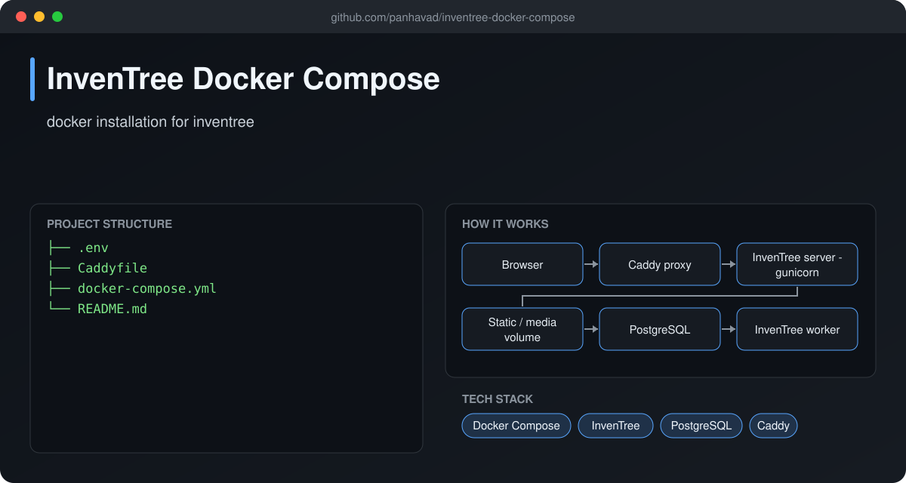
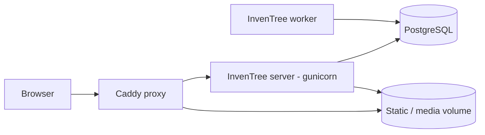

# InvenTree Docker Compose

 [](https://github.com/panhavad/inventree-docker-compose/releases/latest)

A production-ready **Docker Compose setup for InvenTree**, the open-source inventory and parts management system. It brings up PostgreSQL, the InvenTree web server (gunicorn), the background worker and a Caddy reverse proxy with one command.



## Features

- PostgreSQL 13 database
- InvenTree server + django-q background worker
- Caddy reverse proxy for static/media files
- All settings in one `.env` file
- Optional Redis cache

## How it works



## Getting started

```bash
git clone https://github.com/panhavad/inventree-docker-compose
cd inventree-docker-compose
# set INVENTREE_SITE_URL in .env
docker compose run --rm inventree-server invoke update
docker compose up -d
```

## Download

Grab the packaged source from the [latest release](https://github.com/panhavad/inventree-docker-compose/releases/latest).

## Tech stack

- Docker Compose
- InvenTree
- PostgreSQL
- Caddy

## Project structure

```text
inventree-docker-compose/
├── docs/
├── .env
├── Caddyfile
├── docker-compose.yml
└── README.md
```

## Original notes

This is a simplify guide to install Inetree on docker
1. Clone this git to your local machine
2. Modify the `INVENTREE_SITE_URL` to your intented HOST IP
3. Use this command to prepare the environment
   
   `docker compose run --rm inventree-server invoke update`
5. Use this command to bring up the container
   
   `docker compose up`
7. After bring up complete you should be able to access the Inventree via http://your-host-ip
8. This environment by default log in is
   
   Username: `admin`

   Password: `admin123321`
